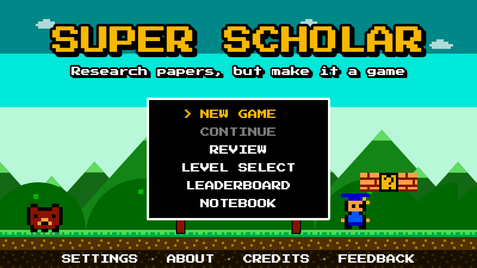
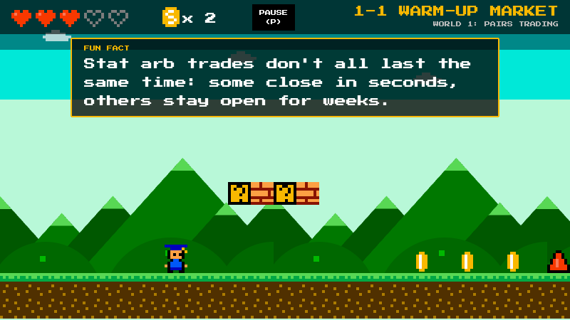
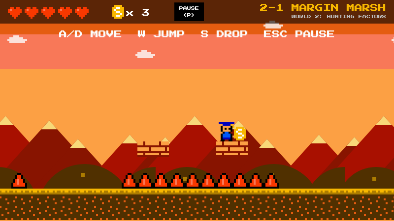
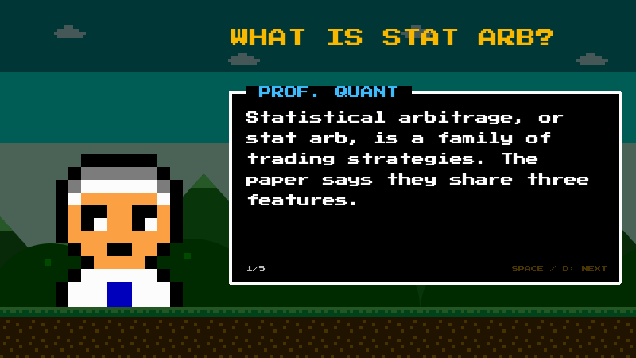
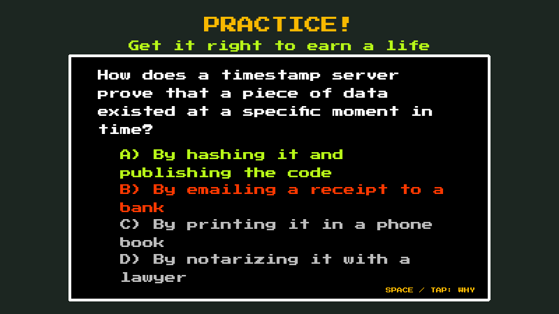
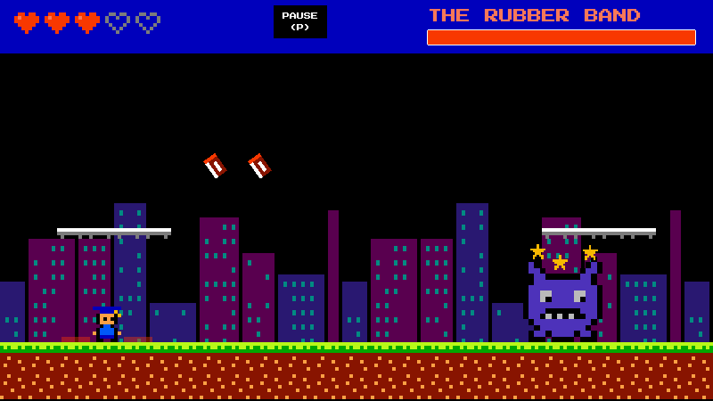
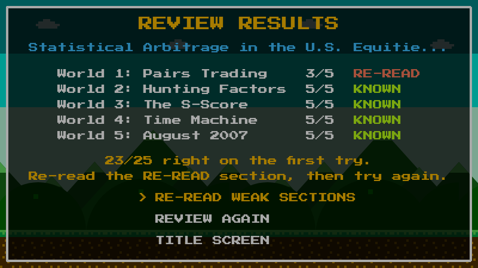
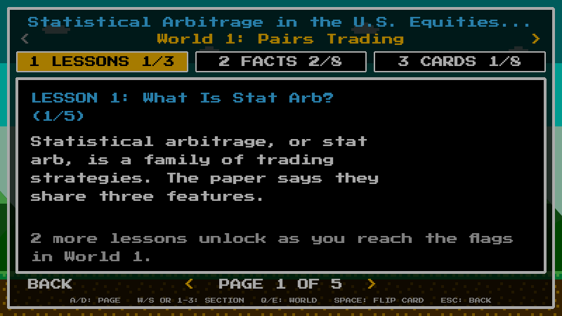

# Super Scholar

**A retro platformer that turns research papers into games you can learn from.**

▶ Play it: https://super-scholar.super-scholar.workers.dev (laptop or phone, no sign-up)

## What it is

Super Scholar turns a dense research paper into an NES-style platformer. Each section of the paper becomes a world:

- **Levels** you run and jump through with WASD (or on-screen controls on a phone): jump chains, running jumps over wide pits, bears to time, and walls to climb. Stomping bears unlocks fun facts from the paper.
- **A lesson** from the professor at the end of every level, followed by a practice question. A wrong pick shows in red with the right answer in green, then an explanation.
- **A boss fight** at the end of every world. Stomp the boss to make it ask a question: a right answer hurts it, a wrong one makes it angrier, and missed questions come back for a second try.
- **Review mode:** already read the paper? Skip the levels and test yourself on one section or all of them, boss by boss. The results mark each section KNOWN or RE-READ, and RE-READ opens that section's lessons, so the loop is test, re-read, test again. MISSED QUESTIONS retests only the questions you got wrong, and drops each one once you answer it right.
- **The Scholar's Notebook:** every lesson, fact, and question you've unlocked, saved as flashcards to study later.
- **Ask the Scholar:** after a lesson, type any question about it and get a short, plain-language answer with an everyday example.

## Why I built it

I wanted to actually read papers like Avellaneda & Lee's *Statistical Arbitrage in the U.S. Equities Market* (2008) without the text being a slog. Turning each idea into a level, a lesson, and a question makes it stick, and it's more fun than rereading.

## Papers

- **Five papers built in**, ready to play instantly: Avellaneda & Lee's *Statistical Arbitrage* (5 hand-written worlds), *Attention Is All You Need*, the Bitcoin whitepaper, *Generative Adversarial Nets*, and a Black-Scholes-Merton paper.
- **167 quiz questions, 117 fun facts, and 250+ lesson pages** across the built-in papers.
- **Any paper:** search 250M+ papers through OpenAlex and play open-access ones straight from the results, or upload any PDF. AI turns its sections into worlds with lessons, questions, and facts, and saves them so the same paper loads instantly next time.

## Features

**Gameplay**
- 3 levels and a boss per world. Levels are generated from hand-designed chunks of four kinds of challenge (jump chains, wide gaps, timing, climbing), seeded per paper so each paper always plays the same, and they get harder with each level and world
- Every generated level is proved beatable with the game's real jump physics: only fair jumps, at most 80% of a perfect jump's reach, with arcs that clear any wall in between
- Five boss styles that rotate by world: the Charger, the Jumper, the Thrower, the Summoner, and the Flyer
- Bears, spikes, pits, moving and drop-through platforms, coins, ? blocks, hearts, and a shield power-up
- 1-3 stars per level and boss, a level select map, an optional HARD mode with harder layouts, and a TOP SCHOLARS leaderboard per paper

**Learning**
- Lessons with back-and-forth paging and short reading lines, so text is easy to follow
- Practice questions after every lesson and quiz questions in every boss fight, with the right answer and an explanation after every miss
- Review mode with per-section scores, RE-READ links into the lessons, and a MISSED QUESTIONS round of just the questions you got wrong
- A Notebook with one screen per paper: switch worlds and LESSONS / FACTS / CARDS tabs in place, question-first flashcards, and a line saying how to unlock what's left

**Polish**
- Chiptune music and sound effects generated in code with Web Audio, with volume settings
- Animated title screen, title cards for every level, pixel particle effects, and a pause menu with a visible pause button
- Question and result boxes centered between the HUD and the ground, widening for long AI-written questions instead of covering the game
- Works on laptops, phones, and tablets (multi-touch controls); progress saves in the browser with CONTINUE
- In-game feedback form

## Tech

- **Frontend:** TypeScript (strict), Phaser 4, Vite, pdf.js for reading uploaded PDFs in the browser
- **Backend:** Cloudflare Workers (static game plus a small API) and Cloudflare KV for saved AI worlds, feedback, and the leaderboard
- **AI:** Gemini 3.5 Flash-Lite, with Gemini 3.1 Flash-Lite and Groq (Llama 3.3 70B) as fallbacks; API keys kept server-side as secrets; AI output is checked for copying, length, and repeated facts before it's played
- **Testing:** Vitest (179 tests) plus 14 Playwright play-through checks that play the real game in a hidden browser and screenshot each screen; every deploy runs both, so a broken jump or an overflowing text box stops the release
- **Security:** Content Security Policy and security headers, rate limits on every API route, input validation, secret scanning, and a dependency audit
- **Tools:** Built with AI assistance

## Process

- Built as my independent project for CS 124 at the University of Illinois (Fall 2026)
- Started from a quick prototype, then grew it one feature at a time, each tested and deployed before the next
- Ran play-tests with classmates and turned their feedback into fixes: a higher jump to reach platforms, no repeated fun facts, a visible pause button, right/wrong answers in green and red, a Notebook that explains itself, a tag on boss questions that come back, a tip when touching the boss hurts, and harder, more engaging levels
- Presented to a group of classmates and built their idea of "learn first, then test yourself" into Review mode
- Moved hosting from Netlify to Cloudflare when frequent deploys used up Netlify's free plan

## Screenshots

*Title screen*

*World 1-1: stomping a bear unlocks a fun fact from the paper*

*Hopping from brick to brick over a bed of candles*

*The professor's lesson at the end of a level*

*Practice question after a wrong pick: the right answer in green, the miss in red*

*Boss fight: the Thrower, dizzy and ready to be stomped*

*Review mode: a score for each section, with RE-READ on the one to study again*

*The Scholar's Notebook: lessons, facts, and flashcards, a world at a time*
